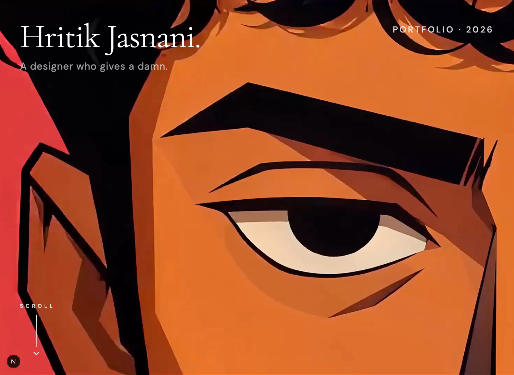

# Hritik Jasnani — Portfolio

I’m **Hritik Jasnani**, a multidisciplinary designer based in India, working globally across brand identity, illustration, and digital experiences.

[View the live portfolio](https://hritikjasnani.vercel.app) · [Instagram](https://instagram.com/hritikjasnani)

## Built with

- [Next.js](https://nextjs.org) and React
- TypeScript
- Tailwind CSS
- GSAP (loaded on desktop when needed)
- Vercel Speed Insights

## Contact

Available for select freelance and collaborative projects.

[hritikjasnani.design@gmail.com](mailto:hritikjasnani.design@gmail.com)

## Development and verification

Use Node.js 22 and install the locked dependencies with `npm ci`.

- `npm run dev` starts local development.
- `npm run check` runs ESLint, TypeScript checks, and a production build.
- `npm test` runs the browser regressions against the production build. Local runs use installed Google Chrome; CI installs Playwright Chromium.
- `npm audit --omit=dev` checks production dependencies.

The browser suite covers intro navigation and resizing, reduced motion, category restoration, modal keyboard focus, clipboard failure, no-JavaScript rendering, contrast, narrow screens, and SEO metadata.

Production dependencies have no known audit findings as of 20 October 2026. The full development audit still reports the unpatched `braces` advisory through Next.js's ESLint tooling; there is no patched upstream release. Do not force a downgrade to an incompatible ESLint configuration to suppress it.
